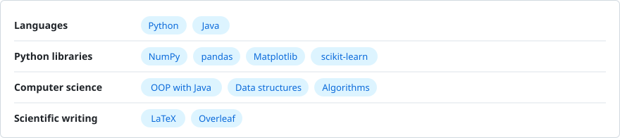

## Hi, I'm Adeeb Alqurashi

I'm a third-year **Data Science** student at **King Fahd University of Petroleum & Minerals (KFUPM)**. I like research and mathematics, and I enjoy turning what I learn into projects that are actually useful. My goal is a career in academic research.

[Email](mailto:adib.alqurashi@gmail.com) · [LinkedIn](https://www.linkedin.com/in/adib-alqurashi-347527444) · [X](https://x.com/adib_alqurashi)

<picture>
  <source media="(prefers-color-scheme: dark)" srcset="assets/glance-dark.svg" />
  <source media="(prefers-color-scheme: light)" srcset="assets/glance-light.svg" />
  
</picture>

### What I'm working on

<picture>
  <source media="(prefers-color-scheme: dark)" srcset="assets/now-dark.svg" />
  <source media="(prefers-color-scheme: light)" srcset="assets/now-light.svg" />
  
</picture>

### Skills

<picture>
  <source media="(prefers-color-scheme: dark)" srcset="assets/skills-dark.svg" />
  <source media="(prefers-color-scheme: light)" srcset="assets/skills-light.svg" />
  
</picture>

### Activity

<picture>
  <source media="(prefers-color-scheme: dark)" srcset="https://raw.githubusercontent.com/adib-alqurashi/adib-alqurashi/output/contrib.svg" />
  <source media="(prefers-color-scheme: light)" srcset="https://raw.githubusercontent.com/adib-alqurashi/adib-alqurashi/output/contrib-light.svg" />
  
</picture>

> *"I have limits. What I create will go beyond them."*
