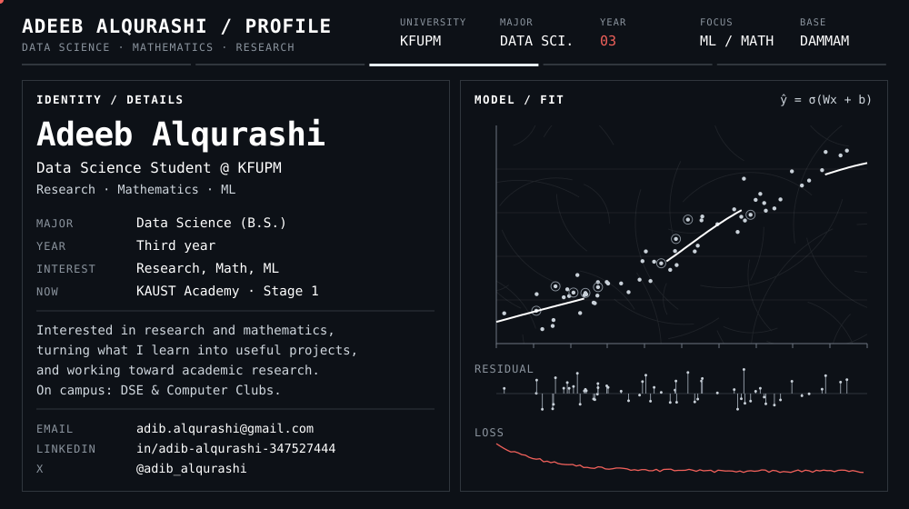
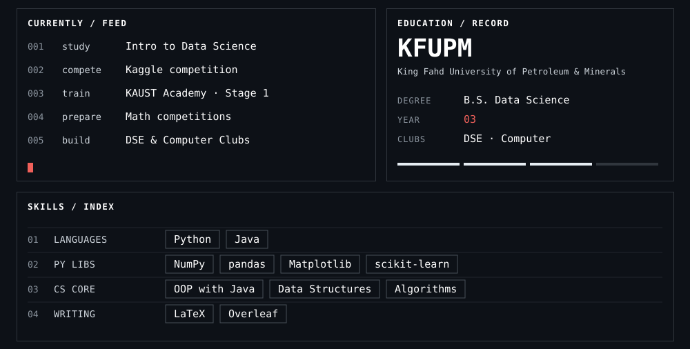

  

  <a href="mailto:adib.alqurashi@gmail.com"><code>EMAIL</code></a>&nbsp;&nbsp;
  <a href="https://www.linkedin.com/in/adib-alqurashi-347527444"><code>LINKEDIN</code></a>&nbsp;&nbsp;
  <a href="https://x.com/adib_alqurashi"><code>X</code></a>

  

  

  

