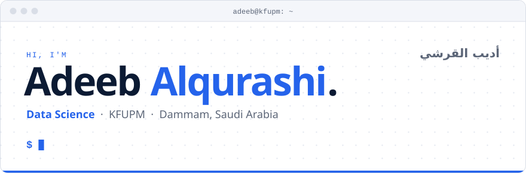
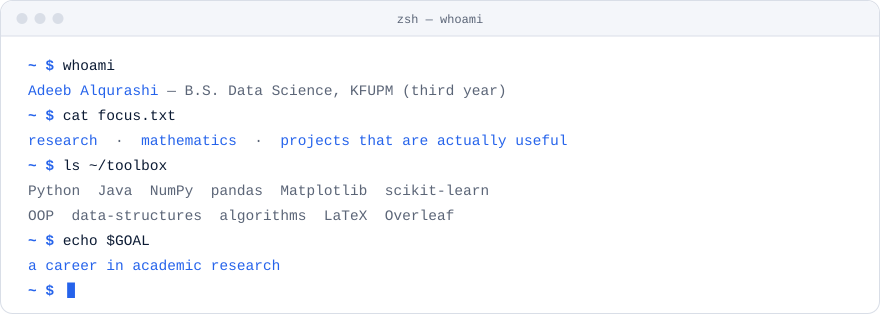
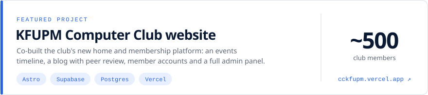

<a href="https://github.com/adib-alqurashi">
  <picture>
    <source media="(prefers-color-scheme: dark)" srcset="assets/hero-dark.svg" />
    <source media="(prefers-color-scheme: light)" srcset="assets/hero-light.svg" />
    
  </picture>
</a>

  <a href="mailto:adib.alqurashi@gmail.com"><picture><source media="(prefers-color-scheme: dark)" srcset="assets/btn-email-dark.svg" /></picture></a>&nbsp;
  <a href="https://www.linkedin.com/in/adib-alqurashi-347527444"><picture><source media="(prefers-color-scheme: dark)" srcset="assets/btn-linkedin-dark.svg" /></picture></a>&nbsp;
  <a href="https://x.com/adib_alqurashi"><picture><source media="(prefers-color-scheme: dark)" srcset="assets/btn-x-dark.svg" /></picture></a>

<picture>
  <source media="(prefers-color-scheme: dark)" srcset="assets/whoami-dark.svg" />
  <source media="(prefers-color-scheme: light)" srcset="assets/whoami-light.svg" />
  
</picture>

### Featured

<a href="https://cckfupm.vercel.app">
  <picture>
    <source media="(prefers-color-scheme: dark)" srcset="assets/featured-dark.svg" />
    <source media="(prefers-color-scheme: light)" srcset="assets/featured-light.svg" />
    
  </picture>
</a>

Live at <a href="https://cckfupm.vercel.app">cckfupm.vercel.app</a> · source in <a href="https://github.com/KFUPM-COMPUTER-CLUB/website">KFUPM-COMPUTER-CLUB/website</a>

### Right now

<picture>
  <source media="(prefers-color-scheme: dark)" srcset="assets/now-dark.svg" />
  <source media="(prefers-color-scheme: light)" srcset="assets/now-light.svg" />
  
</picture>

### Activity

<picture>
  <source media="(prefers-color-scheme: dark)" srcset="https://raw.githubusercontent.com/adib-alqurashi/adib-alqurashi/output/days.svg" />
  <source media="(prefers-color-scheme: light)" srcset="https://raw.githubusercontent.com/adib-alqurashi/adib-alqurashi/output/days-light.svg" />
  
</picture>

<picture>
  <source media="(prefers-color-scheme: dark)" srcset="https://raw.githubusercontent.com/adib-alqurashi/adib-alqurashi/output/snake-dark.svg" />
  <source media="(prefers-color-scheme: light)" srcset="https://raw.githubusercontent.com/adib-alqurashi/adib-alqurashi/output/snake-light.svg" />
  
</picture>

<i>"I have limits. What I create will go beyond them."</i>

