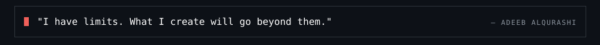

  

  

  &nbsp;
  &nbsp;
  

 

  I'm a third-year <b>Data Science</b> student at <b>King Fahd University of Petroleum &amp; Minerals (KFUPM)</b>. 
  I'm interested in research and mathematics, and in turning what I learn into useful projects. 
  I'm working toward a future in academic research. 
  On campus, I contribute to the <b>DSE</b> and <b>Computer Clubs</b> through applied projects and growth &amp; development committee work.

 

  

  

<h3 align="center">Contribution activity</h3>

  <picture>
    <source media="(prefers-color-scheme: dark)" srcset="https://raw.githubusercontent.com/adib-alqurashi/adib-alqurashi/output/github-snake-dark.svg" />
    <source media="(prefers-color-scheme: light)" srcset="https://raw.githubusercontent.com/adib-alqurashi/adib-alqurashi/output/github-snake.svg" />
    
  </picture>

  

