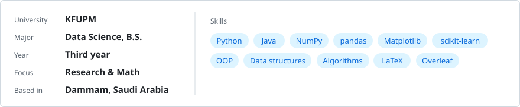
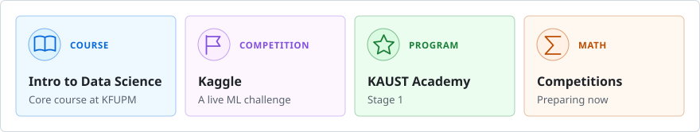

## Hi, I'm Adeeb Alqurashi

I'm a third-year **Data Science** student at **King Fahd University of Petroleum & Minerals (KFUPM)**. I like research and mathematics, and I enjoy turning what I learn into projects that are actually useful. My goal is a career in academic research. On campus, I contribute to the DSE and Computer Clubs.

  <a href="mailto:adib.alqurashi@gmail.com"><picture><source media="(prefers-color-scheme: dark)" srcset="assets/btn-email-dark.svg" /></picture></a>&nbsp;
  <a href="https://www.linkedin.com/in/adib-alqurashi-347527444"><picture><source media="(prefers-color-scheme: dark)" srcset="assets/btn-linkedin-dark.svg" /></picture></a>&nbsp;
  <a href="https://x.com/adib_alqurashi"><picture><source media="(prefers-color-scheme: dark)" srcset="assets/btn-x-dark.svg" /></picture></a>

<picture>
  <source media="(prefers-color-scheme: dark)" srcset="assets/profile-dark.svg" />
  <source media="(prefers-color-scheme: light)" srcset="assets/profile-light.svg" />
  
</picture>

### Right now

<picture>
  <source media="(prefers-color-scheme: dark)" srcset="assets/now-dark.svg" />
  <source media="(prefers-color-scheme: light)" srcset="assets/now-light.svg" />
  
</picture>

### Activity

<picture>
  <source media="(prefers-color-scheme: dark)" srcset="https://raw.githubusercontent.com/adib-alqurashi/adib-alqurashi/output/contrib.svg" />
  <source media="(prefers-color-scheme: light)" srcset="https://raw.githubusercontent.com/adib-alqurashi/adib-alqurashi/output/contrib-light.svg" />
  
</picture>

> *"I have limits. What I create will go beyond them."*
